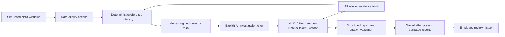

# LeakProbe architecture

This describes the recovered release based on `a0954fb0bd289e39561c35ef5e99794684c72c58`. Submission preparation changes documentation and packaging only.

## Simulation and sensor evidence

`leakprobe/generate_full_net3_dataset.py`, `generate_high_signal_dataset.py` and `net3_benchmark.py` generate observations using WNTR and the bundled EPANET Net3 model. No simulations run during normal dashboard navigation. The canonical source is `data/net3_full_high_signal/`: 500 recorded windows with 92 pressure and 117 flow columns. Pressure is meters of water head; saved flow is L/s. Missing readings remain missing, not zero.

The 1,000-case data and classifier benchmarks are a separate experiment. Earlier difficult Part C experiments are different research conditions, not a new success claim from this high-signal demonstration.

## Deterministic detection

`leakprobe/ui/data_access.py`, `operations.py` and `coverage.py` check coverage, timestamps, freshness, missing readings and baseline compatibility. `net3_tools.py` compares all 209 observed channels with simulated normal and candidate-pipe profiles, selects each hypothesis's best reference fit and ranks normalized RMSE.

Candidate catalogs are fixed by split: 17 development pipes and seven held-out pipes, plus normal. This is constrained single-leak localization, not an unrestricted search over all 117 observed pipes. The high-signal bank has no calibrated rejection cutoff. Fit scores are not probabilities. Truth labels are reserved for evaluation/reference outcomes; they are not inputs to detection or investigation tools.

## Employee interface

`streamlit_app.py` and `leakprobe/ui/employee_dashboard.py` provide record filtering and the Overview, AI Investigation, Sensor Analysis and Employee Review tabs. The map uses actual bundled Net3 topology. History & outcomes contains employee actions; administration contains replay, reference outcomes, Investigation history, Model validation and About. Navigation separation is not authentication.

## NVIDIA Nemotron and Nebius Token Factory

`leakprobe/ui/ai_service.py` reads server-side Streamlit Secrets and creates a client only on an explicit investigation action. The configured model is `nvidia/nemotron-3-super-120b-a12b`, hosted by Nebius Token Factory at `https://api.tokenfactory.us-central1.nebius.com/v1/`.

`leakprobe/agent.py` routes the compact employee workflow through `employee_investigator.py`. Nemotron chooses allowlisted evidence calls in `investigation_evidence.py`: compact observations, sensor summaries, paginated sensor readings, normal comparisons, candidate rankings, network metadata and available operations records. No operations records are bundled. It does not alter the deterministic ranking, run new hydraulic simulations or train a detector. Streamlit hosts the interface; Nebius supplies model inference.

Existing bounds are four model requests, eight tool calls, 2,048 output tokens per request, 30-second SDK timeouts and zero SDK retries. A validation correction uses a remaining request. The review ledger allows two attempts per alert, including failures, and prevents overlapping pending runs for that alert. These are not a dollar cap or a process-wide concurrency limit. Private hosting/viewer access remains the owner's responsibility; Python cannot verify Community Cloud sharing settings.

## Validation, saved reports and human review

`investigation_report.py` checks required report sections and cited evidence against locally reconstructed tool facts, including sensor identities, values, units, signs and ranking facts. Successful API completion alone is insufficient. These checks ground explicit citations; they cannot prove every uncited causal explanation or recommended action.

Each attempt has a unique trace file and completion status. Invalid, incomplete and failed attempts remain separate. The employee view prefers a compatible validated report even if a newer attempt failed. Legacy text is not silently rewritten or promoted to validated status.

`leakprobe/ui/alert_store.py` records acknowledgment, outcomes, reviewer notes and UTC events in local SQLite. A human field-confirmation entry is distinct from a synthetic label. The demo does not authenticate reviewer names, guarantee Cloud-local persistence across restarts or dispatch crews.

## Scope

Implemented: recorded all-channel monitoring, deterministic candidate matching, genuine saved Nemotron reports and optional hosted inference, citation validation, employee review, and separate saved classifier evidence.

Future work: live utility ingestion, unrestricted pipe coverage, durable shared audit storage, identity-backed reviews, field validation, active measurement planning and model fine-tuning. Neither model superiority nor resolution of the difficult Part C research task is demonstrated.

See the [README](../README.md) for setup and original metric denominators, and [third-party notices](../THIRD_PARTY_NOTICES.md) for licensing boundaries.
